# 🔥 Azure Hub-and-Spoke Firewall Architecture with Terraform

[](https://github.com/devinlaws50-wq/terraform-azure-hub-spoke-firewall/actions/workflows/terraform-validate.yml)


A segmented Azure network built with Terraform. Azure Firewall in the hub controls all internet egress from the spokes, Azure Bastion provides private admin access, and firewall logs in Log Analytics prove which traffic was allowed and which was denied.

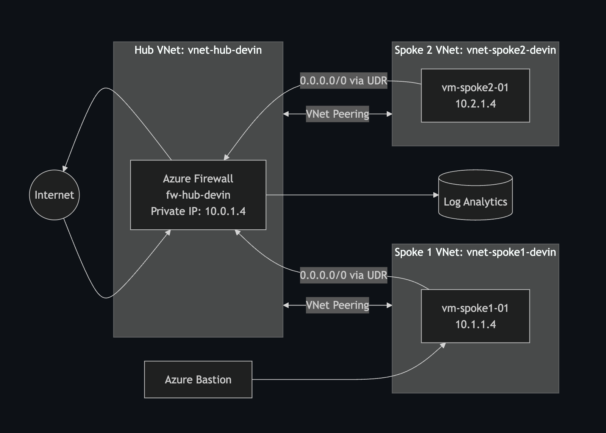

*Hub-and-spoke architecture with centralized Azure Firewall, private spoke workloads, Bastion access, forced egress routing, and Log Analytics monitoring.*

---

## 📑 Table of Contents

- [🔥 Azure Hub-and-Spoke Firewall Architecture with Terraform](#-azure-hub-and-spoke-firewall-architecture-with-terraform)
  - [📑 Table of Contents](#-table-of-contents)
  - [📌 Project Overview](#-project-overview)
  - [🎯 Business and Security Problem](#-business-and-security-problem)
  - [🏗️ Architecture](#️-architecture)
  - [🧰 Technologies Used](#-technologies-used)
  - [🛡️ Security Controls](#️-security-controls)
  - [🚀 Deployment](#-deployment)
    - [Terraform workflow](#terraform-workflow)
  - [✅ Validation](#-validation)
    - [Firewall policy testing](#firewall-policy-testing)
    - [Log analysis](#log-analysis)
  - [📸 Evidence](#-evidence)
    - [Build](#build)
    - [Networking and routing](#networking-and-routing)
    - [Rule enforcement and logging](#rule-enforcement-and-logging)
  - [🧩 Challenges and Troubleshooting](#-challenges-and-troubleshooting)
    - [Traffic routing](#traffic-routing)
    - [Firewall rule validation](#firewall-rule-validation)
    - [CI portability](#ci-portability)
  - [🔐 Security Considerations](#-security-considerations)
    - [Production improvements](#production-improvements)
  - [💰 Cost Considerations](#-cost-considerations)
  - [🧹 Cleanup](#-cleanup)
  - [🏆 Key Outcomes](#-key-outcomes)
  - [🧠 Skills Demonstrated](#-skills-demonstrated)
  - [📂 Repository Structure](#-repository-structure)

---

## 📌 Project Overview

This project implements a secure Azure hub-and-spoke network architecture using Terraform.

Azure Firewall is centralized in the hub virtual network and acts as the primary egress security control for spoke workloads. User-defined routes force internet-bound traffic from the spoke networks through the firewall, while Azure Bastion provides administrative access to private virtual machines without requiring public IP addresses.

Firewall diagnostics are forwarded to Log Analytics, allowing both permitted and denied traffic to be validated through KQL queries.

The project demonstrates how networking, routing, security enforcement, private administrative access, and centralized monitoring work together in a segmented Azure environment.

---

## 🎯 Business and Security Problem

As cloud environments grow, independently managing routing, internet access, and security controls in every workload network can create inconsistent policies and unnecessary operational overhead.

A centralized hub-and-spoke design addresses this by placing shared network and security services in a central hub while keeping workloads separated across spoke networks.

This architecture was designed to demonstrate:

- Centralized network security enforcement
- Controlled internet egress
- Segmentation between workloads
- Private administrative access
- Centralized traffic logging and monitoring
- Repeatable infrastructure deployment using Terraform

---

## 🏗️ Architecture

The environment uses one hub virtual network and two spoke virtual networks.

- **Hub:** hosts Azure Firewall and Azure Bastion
- **Spokes:** host the workload virtual machines
- **Connectivity:** VNet peering links the hub to each spoke
- **Routing:** user-defined routes on the spoke subnets send default outbound traffic to the Azure Firewall private IP, creating a centralized inspection point

---

## 🧰 Technologies Used

| Technology             | Purpose                                       |
| ---------------------- | --------------------------------------------- |
| Terraform              | Infrastructure as Code deployment             |
| Microsoft Azure        | Cloud platform                                |
| Azure Virtual Network  | Hub and spoke network segmentation            |
| VNet Peering           | Connectivity between hub and spoke VNets      |
| Azure Firewall         | Centralized traffic filtering                 |
| Azure Firewall Policy  | Application and network rule management       |
| User-Defined Routes    | Forced egress through Azure Firewall          |
| Azure Bastion          | Private administrative access to VMs          |
| Linux Virtual Machines | Spoke workloads used for validation           |
| Log Analytics          | Centralized firewall log collection           |
| Azure Monitor          | Monitoring and diagnostic integration         |
| Network Watcher        | Connectivity validation                       |
| GitHub Actions         | Automated Terraform formatting and validation |

---

## 🛡️ Security Controls

| Control                          | How it is implemented                                                                                                                                                     |
| -------------------------------- | ------------------------------------------------------------------------------------------------------------------------------------------------------------------------- |
| **Centralized egress filtering** | Default routes from the spoke subnets send internet-bound traffic through Azure Firewall instead of letting workloads reach the internet directly.                        |
| **Private workload access**      | The Linux VMs use private IPs only. Azure Bastion provides browser-based SSH to the private workload VM.                                                                  |
| **SSH key authentication**       | VM authentication uses SSH public keys, not passwords. The key is supplied through a Terraform variable so the configuration does not depend on a local workstation path. |
| **Network segmentation**         | Separate spoke VNets separate workload environments while the hub centralizes shared infrastructure.                                                                      |
| **Application-level filtering**  | Firewall application rules allow approved FQDN destinations and deny everything that does not match.                                                                      |
| **Centralized logging**          | Firewall diagnostic logs are sent to Log Analytics for query, investigation, and validation.                                                                              |
| **Infrastructure validation**    | GitHub Actions checks formatting and validity on every push to `main` and every pull request.                                                                             |

The CI workflow runs:

```bash
terraform fmt -check -recursive
terraform init -backend=false
terraform validate
```

---

## 🚀 Deployment

The environment was deployed to the **East US** region in the resource group `rg-wk17-hub-spoke-devin`.

Terraform provisions:

- Hub virtual network
- Two spoke virtual networks
- VNet peering
- Azure Firewall and Azure Firewall Policy
- Route tables
- Linux workload VMs
- Azure Bastion
- Log Analytics integration and diagnostic settings

### Terraform workflow

```bash
cd terraform

terraform init
terraform fmt
terraform validate
terraform plan
terraform apply
```

Environment-specific values belong in a local `terraform.tfvars` file based on `terraform.tfvars.example`. Terraform state and local variable files are intentionally excluded from source control.

---

## ✅ Validation

Deployment validation focused on proving that traffic followed the intended path and that firewall policy decisions were enforced.

| Check                   | Result                                                                                 |
| ----------------------- | -------------------------------------------------------------------------------------- |
| **Resource group**      | Contains all components of the hub-and-spoke environment.                              |
| **Azure Firewall**      | Deployed inside the hub VNet as the centralized egress control.                        |
| **Firewall policy**     | Associated with the `fwp-hub-devin` policy that manages application and network rules. |
| **VNet peering**        | Hub peered with both spoke VNets.                                                      |
| **Forced egress route** | UDR sends `0.0.0.0/0` from the spoke subnet to the firewall private IP `10.0.1.4`.     |
| **Private addressing**  | `vm-spoke1-01` → `10.1.1.4`, `vm-spoke2-01` → `10.2.1.4`                               |
| **Diagnostic logging**  | Firewall diagnostic settings forward activity to Log Analytics.                        |

### Firewall policy testing

Testing was performed from `vm-spoke1-01` through Azure Bastion. Requests were sent to three destinations:

| Destination         | Result    |
| ------------------- | --------- |
| `www.microsoft.com` | ✅ Allowed |
| `www.bing.com`      | ✅ Allowed |
| `example.com`       | ❌ Denied  |

This validated selective application-rule enforcement rather than unrestricted outbound access.

The `app-allow-web` application rule collection used:

- **Priority:** 100
- **Action:** Allow
- **Source:** `10.1.1.4`
- **Destinations:** approved FQDNs

Network Watcher Connection Monitor was configured as an additional connectivity-validation mechanism.

### Log analysis

Firewall logs were queried through Log Analytics. This KQL query isolates application-rule activity from the spoke workload:

```kusto
AzureDiagnostics
| where Category == "AzureFirewallApplicationRule"
| where TimeGenerated > ago(30m)
| where msg_s has "10.1.1.4"
| project TimeGenerated, msg_s
| order by TimeGenerated desc
```

The results showed:

- Allow decisions for `www.microsoft.com`
- Allow decisions for `www.bing.com`
- Deny decisions for `example.com`

This confirmed that firewall policy decisions were both enforced and recorded.

---

## 📸 Evidence

### Build

|                                                                 |                                                                       |
| :-------------------------------------------------------------: | :-------------------------------------------------------------------: |
| 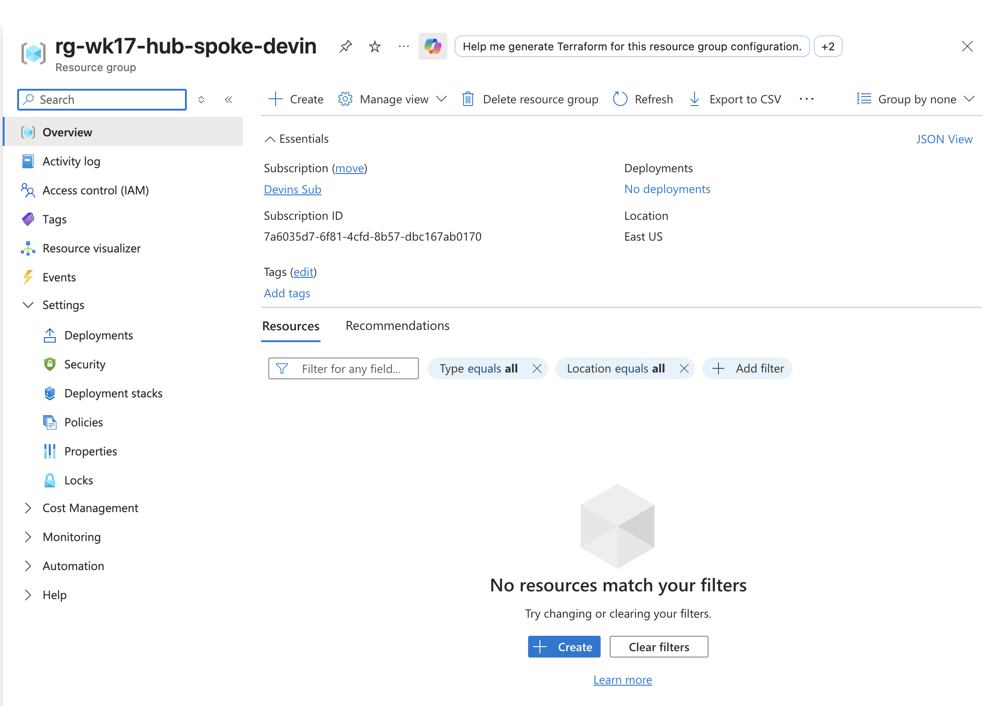 | 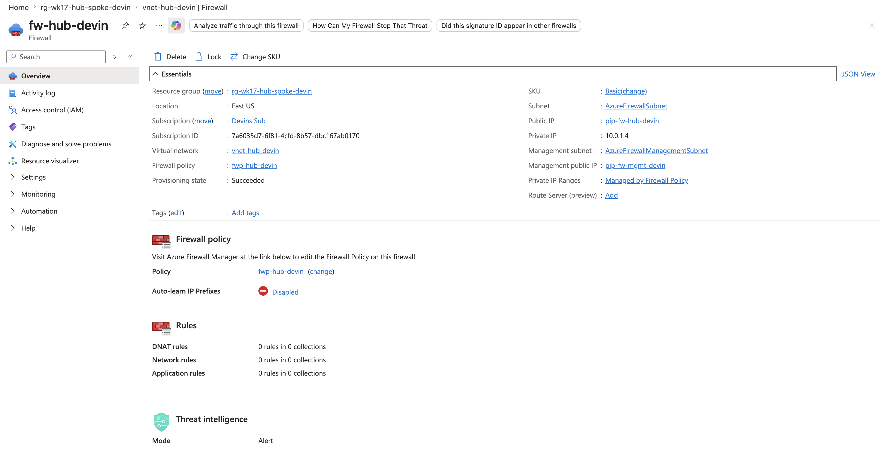 |
|                    *Resource group contents*                    |                       *Azure Firewall overview*                       |
| 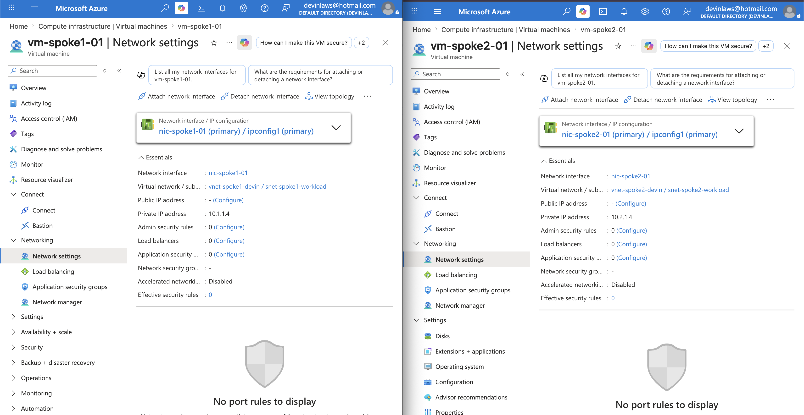 | 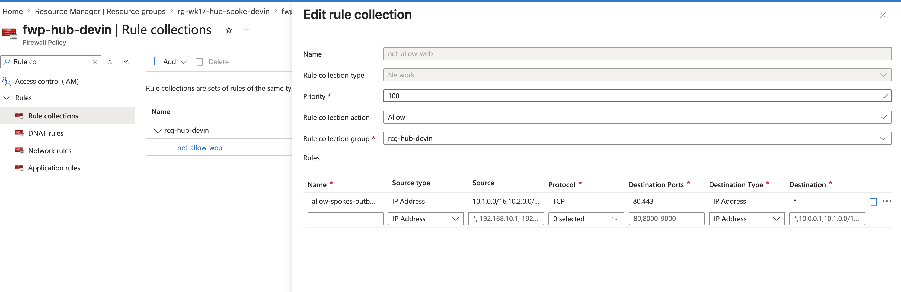 |
|                  *Workload VMs on private IPs*                  |                           *Firewall policy*                           |

### Networking and routing

|                                                                 |                                                                       |
| :-------------------------------------------------------------: | :-------------------------------------------------------------------: |
| 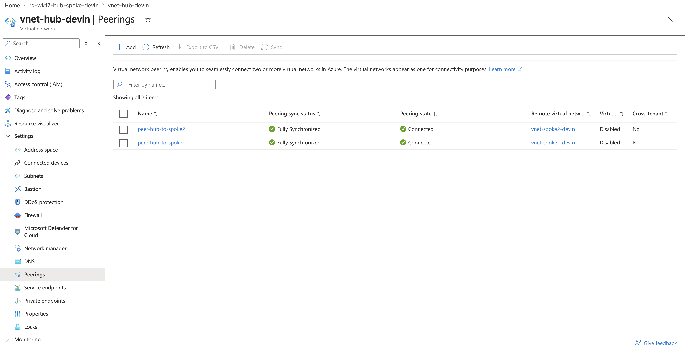 | 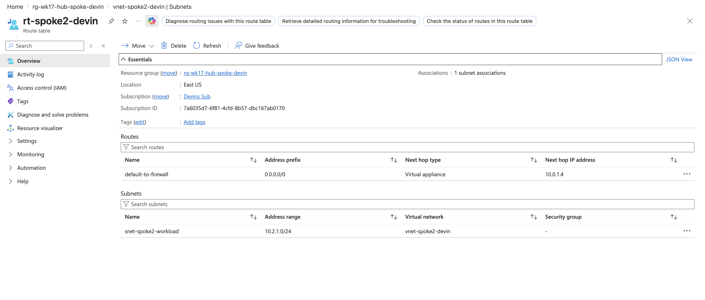 |
|                  *Hub and spoke VNet peering*                   |             *Route table forcing egress to the firewall*              |

### Rule enforcement and logging

|                                                                                       |                                                                               |
| :-----------------------------------------------------------------------------------: | :---------------------------------------------------------------------------: |
|         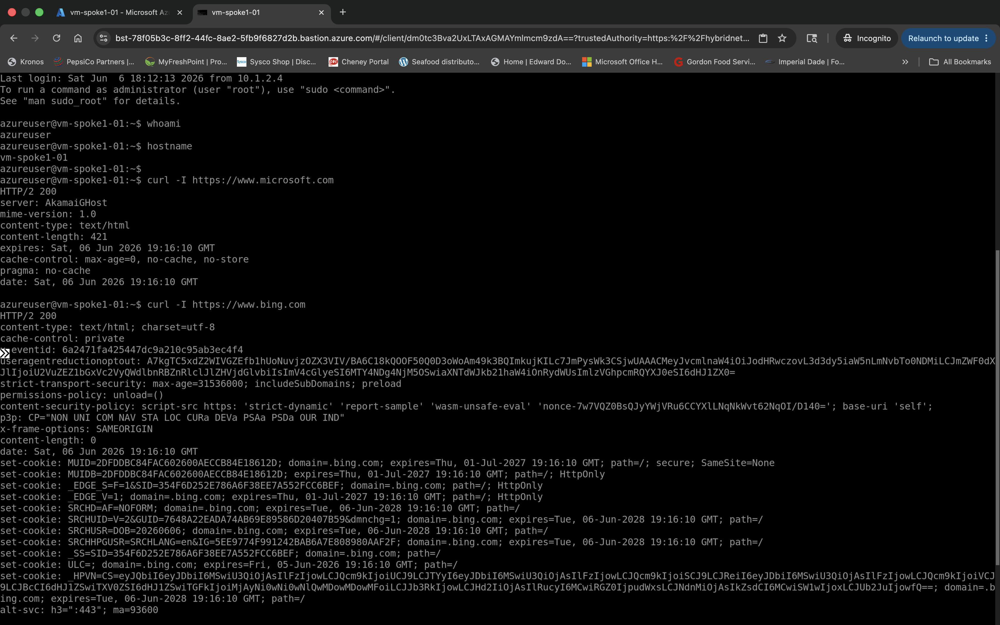         |  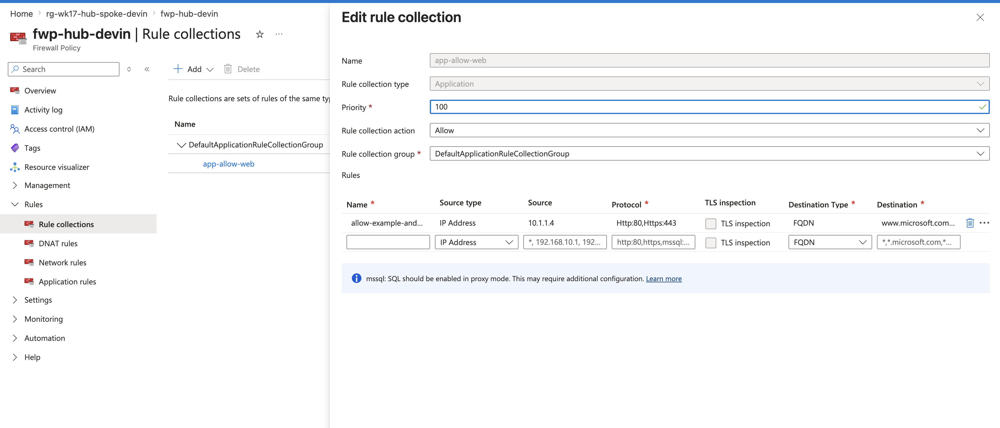  |
|                  *Outbound tests from the spoke VM through Bastion*                   |                         *Application rule collection*                         |
| 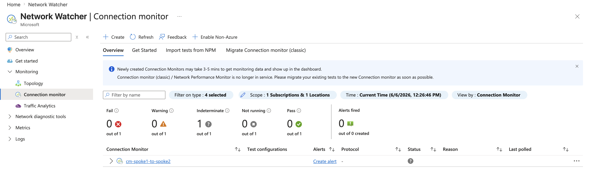 | 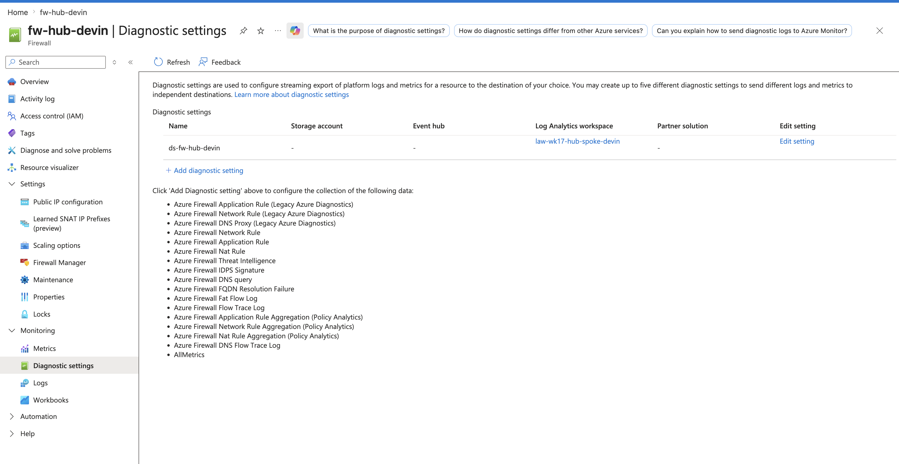 |
|                       *Network Watcher connectivity validation*                       |                        *Traffic logs in Log Analytics*                        |

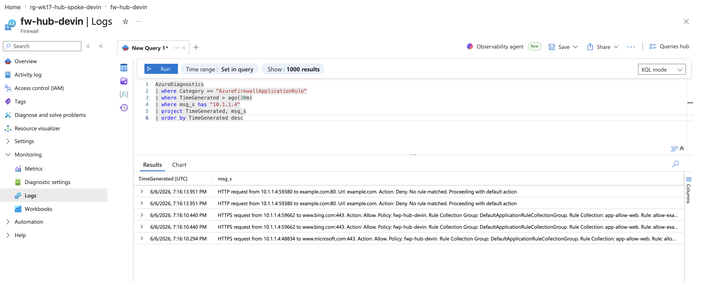

*KQL results showing allowed and denied firewall decisions.*

---

## 🧩 Challenges and Troubleshooting

### Traffic routing

Deploying Azure Firewall alone does not force spoke traffic through it. User-defined routes had to be associated with the spoke subnets so the default route pointed to the firewall private IP.

### Firewall rule validation

A successful connection by itself did not prove the policy was working. Both allowed and denied destinations were tested, then confirmed again in the firewall logs.

### CI portability

The original configuration referenced a workstation-specific SSH key path:

```hcl
~/.ssh/id_rsa.pub
```

GitHub Actions correctly flagged that this file would not exist on another runner. The configuration was refactored to accept the key through `var.ssh_public_key`, which made it portable across environments.

---

## 🔐 Security Considerations

This project follows several security-focused design practices:

- Workload VMs do not need directly exposed public IPs for administration
- Administrative access goes through Azure Bastion
- Password authentication is disabled on the Linux VMs, and SSH public keys are used instead
- Internet-bound traffic is centrally routed through Azure Firewall
- Application rules restrict permitted outbound destinations
- Firewall logs are centrally collected for analysis
- Terraform state and local `.tfvars` files are excluded from Git
- GitHub Actions runs with read-only repository permissions
- CI validates the configuration without Azure credentials and without deploying anything

### Production improvements

For a production environment, I would add:

- Remote Terraform state with locking
- Azure Key Vault integration
- Private DNS architecture
- Azure Firewall Premium capabilities
- Additional NSG controls
- Centralized identity integration
- Multi-environment Terraform modules
- Policy-as-code enforcement

---

## 💰 Cost Considerations

Azure Firewall and Azure Bastion are billable resources and can create meaningful costs even in a lab environment.

For temporary testing environments:

- Deploy only when actively testing
- Monitor Azure Cost Management
- Destroy unused resources promptly
- Avoid leaving Azure Firewall or Bastion running unnecessarily

---

## 🧹 Cleanup

When the environment is no longer needed:

```bash
cd terraform
terraform destroy
```

Review the destruction plan before confirming.

> Terraform state is intentionally not committed to GitHub, so destruction must be run from the environment that holds the corresponding local or remote state.

---

## 🏆 Key Outcomes

This project demonstrated the ability to:

- Design a segmented Azure hub-and-spoke architecture
- Deploy Azure infrastructure using Terraform
- Centralize outbound filtering through Azure Firewall
- Configure forced routing using UDRs
- Secure administrative access with Azure Bastion
- Implement SSH key authentication
- Apply application-level firewall rules
- Forward firewall diagnostics to Log Analytics
- Analyze allowed and denied traffic with KQL
- Validate network behavior through multiple tools
- Build portable Terraform configurations
- Implement automated Terraform CI validation with GitHub Actions

---

## 🧠 Skills Demonstrated

**Azure:** Azure Networking · Azure Firewall · Hub-and-Spoke Architecture · VNet Peering · User-Defined Routes · Azure Bastion · Log Analytics · Azure Monitor · Network Watcher · KQL

**Infrastructure as Code and CI/CD:** Terraform · Infrastructure as Code · Git · GitHub Actions · CI/CD

**Security and Operations:** Cloud Security · Network Segmentation · Firewall Policy Management · SSH Security · Linux Administration

---

## 📂 Repository Structure

```text
.
├── .github/
│   └── workflows/
│       └── terraform-validate.yml
├── diagrams/
│   └── wk17-diagram.png
├── screenshots/
│   ├── wk17-build-01-resource-group.png
│   ├── wk17-build-03-firewall-overview.png
│   ├── wk17-build-04-vm-private-ips.png
│   ├── wk17-hub-spoke-01-firewall-policy.png
│   ├── wk17-hub-spoke-02-vnet-peering.png
│   ├── wk17-hub-spoke-03-udr-route-table.png
│   ├── wk17-hub-spoke-04-flow-logs-la.png
│   ├── wk17-hub-spoke-05-bastion-curl.png
│   ├── wk17-hub-spoke-06-fw-app-rule.png
│   ├── wk17-hub-spoke-06-network-watcher-capture.png
│   └── wk17-hub-spoke-07-fw-logs-allow-deny.png
├── terraform/
│   ├── .terraform.lock.hcl
│   ├── main.tf
│   ├── outputs.tf
│   ├── provider.tf
│   ├── terraform.tfvars.example
│   ├── variables.tf
│   └── versions.tf
├── .gitignore
└── README.md
```
vm-spoke2-01 → 10.2.1.4

Diagnostic Logging

Azure Firewall diagnostic settings forward firewall activity into Log Analytics for centralized visibility.

Firewall Policy Testing

Testing was performed from vm-spoke1-01 through Azure Bastion.

Requests were generated to:

www.microsoft.com
www.bing.com
example.com

Microsoft and Bing were allowed, while example.com remained denied.

This validated selective application-rule enforcement rather than unrestricted outbound access.

Application Rule

The app-allow-web application rule collection used:

Priority: 100
Action: Allow
Source: 10.1.1.4

with approved destination FQDNs.

Network Watcher Validation

Network Watcher Connection Monitor was configured as an additional connectivity-validation mechanism.

Log Analysis

Azure Firewall logs were queried through Log Analytics.

The following KQL query was used to isolate application-rule activity originating from the spoke workload:

AzureDiagnostics
| where Category == "AzureFirewallApplicationRule"
| where TimeGenerated > ago(30m)
| where msg_s has "10.1.1.4"
| project TimeGenerated, msg_s
| order by TimeGenerated desc

The results showed:

Allow decisions for www.microsoft.com
Allow decisions for www.bing.com
Deny decisions for example.com

This confirmed that firewall policy decisions were both enforced and recorded.

Challenges and Troubleshooting
Traffic Routing

Deploying Azure Firewall alone does not automatically force spoke traffic through it.

User-defined routes had to be associated with the spoke subnets so their default route pointed to the firewall private IP.

Firewall Rule Validation

Successful connectivity by itself was not enough to prove the firewall policy was functioning correctly.

Both allowed and denied destinations were tested so that rule behavior could be validated from the workload and again through firewall logs.

CI Portability

The original Terraform configuration referenced a workstation-specific SSH public-key path:

~/.ssh/id_rsa.pub

GitHub Actions correctly identified that this dependency would not exist on another runner.

The configuration was refactored to accept the SSH public key through:

var.ssh_public_key

making the Terraform configuration portable across environments.

Security Considerations

This project follows several security-focused design practices:

Workload VMs do not require directly exposed public IPs for administration.
Administrative access is provided through Azure Bastion.
Password authentication is disabled on the Linux VMs.
SSH public-key authentication is used instead.
Internet-bound traffic is centrally routed through Azure Firewall.
Application rules restrict permitted outbound destinations.
Firewall logs are centrally collected for analysis.
Terraform state and local .tfvars files are excluded from Git.
GitHub Actions operates with read-only repository permissions for validation.
CI performs validation without requiring Azure credentials or deploying infrastructure.

For a production environment, additional improvements could include:

Remote Terraform state with locking
Azure Key Vault integration
Private DNS architecture
Azure Firewall Premium capabilities
Additional NSG controls
Centralized identity integration
Multi-environment Terraform modules
Policy-as-code enforcement
Cost Considerations

Azure Firewall and Azure Bastion are billable resources and can create meaningful costs even in a lab environment.

For temporary testing environments:

Deploy only when actively testing.
Monitor Azure Cost Management.
Destroy unused resources promptly.
Avoid leaving Azure Firewall or Bastion running unnecessarily.
Cleanup

When the environment is no longer required:

cd terraform
terraform destroy

Review the destruction plan before confirming.

Because Terraform state is intentionally not committed to GitHub, destruction should be performed from the environment containing the corresponding local or remote state.

Key Outcomes

This project demonstrated the ability to:

Design a segmented Azure hub-and-spoke architecture
Deploy Azure infrastructure using Terraform
Centralize outbound filtering through Azure Firewall
Configure forced routing using UDRs
Secure administrative access with Azure Bastion
Implement SSH key authentication
Apply application-level firewall rules
Forward firewall diagnostics to Log Analytics
Analyze allowed and denied traffic with KQL
Validate network behavior through multiple tools
Build portable Terraform configurations
Implement automated Terraform CI validation with GitHub Actions
Skills Demonstrated
Azure Networking
Azure Firewall
Hub-and-Spoke Architecture
Terraform
Infrastructure as Code
VNet Peering
User-Defined Routes
Azure Bastion
Linux Administration
SSH Security
Log Analytics
Azure Monitor
KQL
Network Watcher
Network Segmentation
Firewall Policy Management
Cloud Security
Git
GitHub Actions
CI/CD
Repository Structure
.
├── .github/
│   └── workflows/
│       └── terraform-validate.yml
├── diagrams/
│   └── wk17-diagram.png
├── screenshots/
│   ├── wk17-build-01-resource-group.png
│   ├── wk17-build-03-firewall-overview.png
│   ├── wk17-build-04-vm-private-ips.png
│   ├── wk17-hub-spoke-01-firewall-policy.png
│   ├── wk17-hub-spoke-02-vnet-peering.png
│   ├── wk17-hub-spoke-03-udr-route-table.png
│   ├── wk17-hub-spoke-04-flow-logs-la.png
│   ├── wk17-hub-spoke-05-bastion-curl.png
│   ├── wk17-hub-spoke-06-fw-app-rule.png
│   ├── wk17-hub-spoke-06-network-watcher-capture.png
│   └── wk17-hub-spoke-07-fw-logs-allow-deny.png
├── terraform/
│   ├── .terraform.lock.hcl
│   ├── main.tf
│   ├── outputs.tf
│   ├── provider.tf
│   ├── terraform.tfvars.example
│   ├── variables.tf
│   └── versions.tf
├── .gitignore
└── README.md